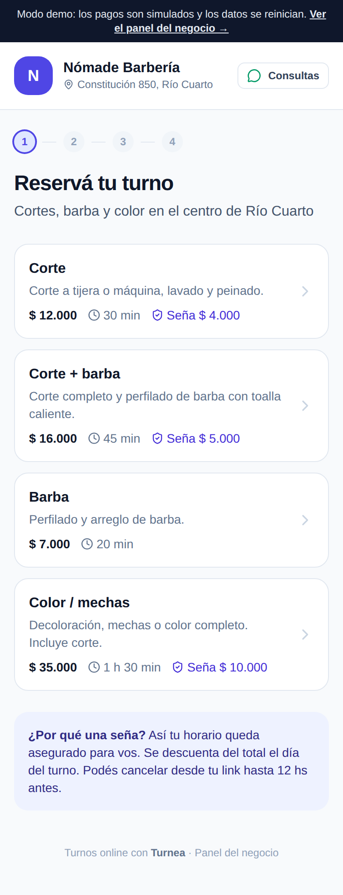
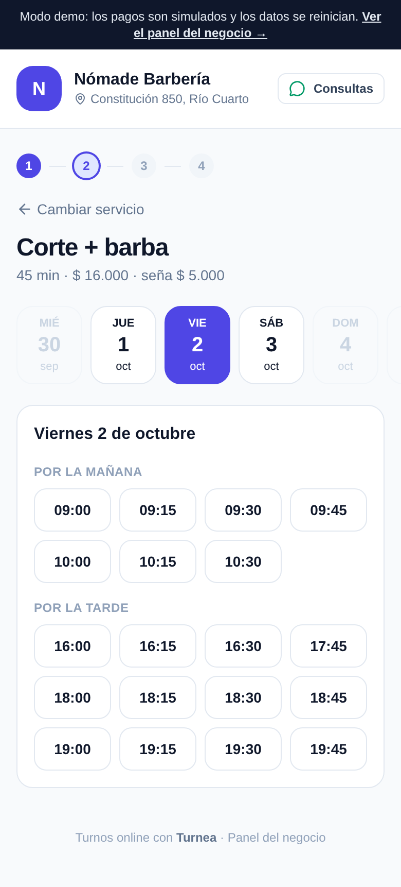
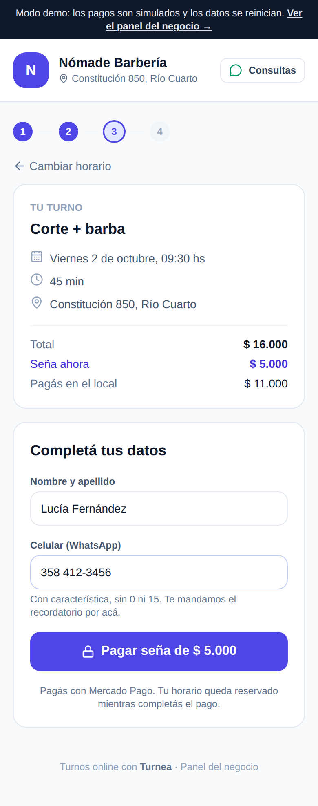
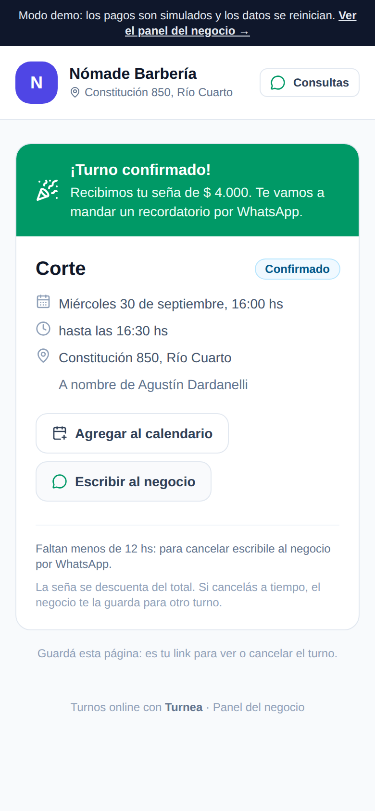
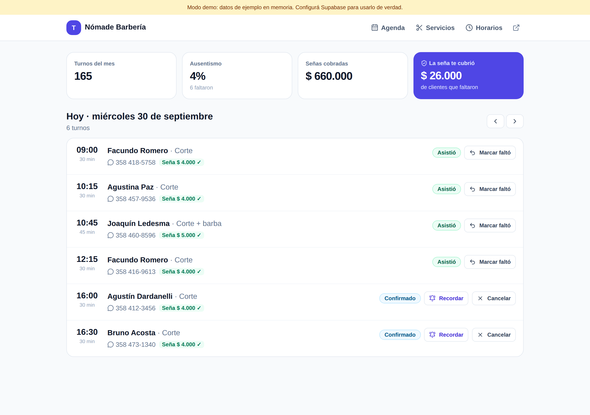

# 📅 Turnea · Turnos online con seña por Mercado Pago

Sistema de turnos para peluquerías, barberías, centros de estética y consultorios. El cliente elige servicio, día y horario, **paga una seña con Mercado Pago** y el turno se confirma solo. El negocio ve su agenda, marca quién vino y quién faltó, y sabe cuánta plata le cubrió la seña.

<p>
  
  
  
  
</p>

## El problema

En Río Cuarto la mayoría de los negocios toma turnos por WhatsApp o Instagram. El cliente reserva, no va, y ese horario se pierde. Pedir seña a mano implica pasar el alias, esperar el comprobante y chequear transferencias. Las plataformas grandes existen, pero cobran planes mensuales pensados para cadenas.

## La solución

1. El cliente entra al link del negocio, elige servicio y ve **solo los horarios realmente libres**.
2. Completa nombre y celular y paga la seña con **Mercado Pago**. Mientras paga, el horario queda **reservado 15 minutos** para que nadie se lo pise.
3. Mercado Pago avisa al **webhook**, el turno se confirma y el cliente recibe su link para ver o cancelar el turno.
4. Un día antes sale el **recordatorio por WhatsApp**.
5. En el panel, el negocio ve la agenda, marca asistencias y mide el ausentismo.



## Lo técnico que resuelve

| Desafío | Cómo lo resuelve |
| --- | --- |
| **Que nunca haya dos turnos superpuestos**, aunque dos personas reserven en el mismo segundo | Restricción de exclusión en PostgreSQL (`EXCLUDE USING gist (tstzrange(...) WITH &&)`) que solo aplica a los estados que ocupan el horario. La app valida antes, pero la garantía está en la base de datos. |
| **Reservar el horario mientras se paga** sin bloquearlo para siempre | Estado `pendiente_pago` con `hold_until`. Las reservas vencidas se liberan antes de cada inserción y con un cron. |
| **Webhook de Mercado Pago confiable** | Verificación de firma `x-signature` (HMAC-SHA256, con protección contra *replay*). Nunca confía en el body: re-consulta el pago en la API. Es **idempotente**: la misma notificación dos veces no hace nada extra. Responde 500 ante errores para que Mercado Pago reintente. |
| **Pago que llega tarde** | Si el horario sigue libre, recupera el turno. Si otro lo tomó, lo marca "para devolver" y el panel ofrece el mensaje de WhatsApp listo para el cliente. |
| **Cálculo de horarios** | Función pura que cruza franjas de atención (mañana/tarde), duración del servicio, anticipación mínima, días bloqueados y turnos ocupados. |
| **Zona horaria** | Todo en hora argentina (UTC-3 fija), independiente de que el servidor corra en UTC. |
| **Clientes sin cuenta** | Cada turno tiene un token secreto (se guarda solo el hash SHA-256 y se compara en tiempo constante) para ver o cancelar. |
| **Seguridad de datos** | RLS activado sin políticas: la API pública de Supabase no expone nada. Todo pasa por el servidor. |

## Stack

- **Next.js 16** (App Router, Server Actions, Route Handlers) · TypeScript · Tailwind CSS 4
- **Supabase / PostgreSQL** (exclusion constraints con `btree_gist`)
- **Mercado Pago Checkout Pro** (API REST + webhooks)
- **Vercel Cron** para recordatorios y liberar reservas · **WhatsApp Cloud API** (opcional)
- **Vitest** (32 tests) · Playwright para pruebas end-to-end · Zod

## Probalo en 1 minuto (modo demo)

```bash
npm install
npm run dev
```

Abrí http://localhost:3000. Sin variables de entorno funciona en **modo demo**: una barbería de ejemplo con un mes de turnos cargados y el pago de Mercado Pago simulado (ejecuta la misma lógica que el webhook). El panel está en `/panel`.

## Ponerlo en producción

1. **Supabase:** creá un proyecto y ejecutá `supabase/schema.sql` en el SQL Editor.
2. **Mercado Pago:** en *Tus integraciones* creá una aplicación. Copiá el Access Token y configurá el webhook `https://TU-DOMINIO/api/mp/webhook` (evento *Pagos*) para obtener la clave secreta.
3. **Vercel:** importá el repo y cargá las variables de `.env.example`: `SUPABASE_URL`, `SUPABASE_SERVICE_ROLE_KEY`, `PANEL_PASSWORD`, `MP_ACCESS_TOKEN`, `MP_WEBHOOK_SECRET`, `CRON_SECRET` y `NEXT_PUBLIC_SITE_URL`.
4. El cron de `vercel.json` corre una vez por día (límite del plan gratis). Con el plan Pro se puede pasar a cada hora.

Recordatorios: sin WhatsApp Cloud API, el panel muestra un botón **Recordar** que abre WhatsApp con el mensaje listo. Con la API configurada (`WHATSAPP_*`) salen solos.

## Tests

```bash
npm test
```

Cubren el cálculo de horarios (franjas, superposición, anticipación, días bloqueados, reservas vencidas), la firma del webhook, la idempotencia de los pagos, los pagos tardíos, la cancelación, la normalización de celulares argentinos y las métricas. El esquema SQL se probó en PostgreSQL 16: rechaza superposiciones con `23P01`, permite turnos consecutivos e ignora los cancelados.

## Estructura

```
src/lib/slots.ts          cálculo de horarios disponibles
src/lib/booking.ts        crear turno, aplicar pago (idempotente), cancelar
src/lib/mercadopago.ts    preferencia, consulta de pago y firma del webhook
src/lib/data/             repositorio: demo en memoria o Supabase
src/app/api/mp/webhook    notificaciones de Mercado Pago
src/app/api/cron/...      recordatorios y liberación de reservas
src/app/panel/            agenda, servicios, horarios y días bloqueados
supabase/schema.sql       tablas, restricción anti-superposición y RLS
```

## Roadmap

- Varios profesionales por negocio (agenda por persona)
- Turnos cargados a mano desde el panel (clientes que llaman por teléfono)
- Devolución automática de señas con la API de reembolsos de Mercado Pago
- Multi-negocio (un solo deploy para varios clientes)

---

Hecho por [Agustín Dardanelli](https://github.com/Agustindardanelli-stack) · Dardanelli Software · Río Cuarto
